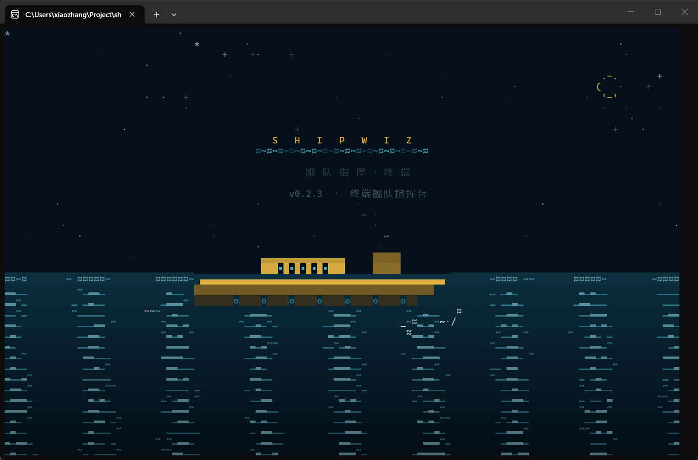

# ShipWiz

轻量级 Docker 桌面客户端，以航海为界面主题。基于 Tauri 2 + Vue 3 + Rust，可通过本机、TLS 或 SSH 三种通道连接 Docker 引擎。

## 功能

- **舰队（节点）**：本机 / TLS / SSH 三种接入方式，连接检测与在线状态
- **集装箱（容器）**：卡片/表格视图、创建（图纸输入支持本舰图纸库预判）、启停、重启、删除、日志查看、容器内交互终端
- **图纸（镜像）**：市场式浏览（热门关键词、官方/社区筛选、按收藏排序）、采购详情、拉取、删除、导出与导入
- **编队（Compose）**：YAML 编辑与校验、up/down、日志、模板
- **监控**：容器与引擎资源总览
- **补给港**：镜像仓库（Registry）管理与默认仓库设置
- **版本更新**：桌面端与 TUI 启动后自动检查 GitHub Release，支持 24 小时缓存、跳过版本与强制复查；桌面端可校验签名并一键下载、安装、重启
- **终端界面**：k9s / lazydocker 风格全屏 TUI，六个工作区、舰船破浪启动动画、按需绘制与当前页定时刷新
- **真实进度**：桌面端与 TUI 展示 Docker 镜像分层拉取状态和已知的字节进度，不虚构未知大小
- **界面**：深海/浅海主题、200px/56px 折叠侧栏、加载/空态/错误态三态反馈、航海主题操作通知动画

## 技术栈

| 层 | 选型 |
|---|---|
| 桌面框架 | Tauri 2 |
| 前端 | Vue 3、TypeScript、NaiveUI、Pinia、Vue Router、Vite |
| 终端与编辑器 | xterm.js、Monaco Editor |
| 后端 | Rust、Bollard（Docker API）、ssh2、keyring |
| 打包 | Vite + Tauri CLI |

## 目录结构

```
src-frontend/       Vue 3 前端（视图、组件、store、API 封装）
src-backend/        Rust 后端（Tauri 命令、Docker、SSH、终端、配置）
src-backend/src/cli CLI 入口（与桌面端共用配置和 Docker/SSH 逻辑）
examples/           启动动画独立预览（splash_demo）
npm/                shipwiz-cli 的 npm 安装包（从 GitHub Release 下载二进制）
capabilities/       Tauri 权限配置
tauri.conf.json     应用与窗口配置
Cargo.toml          Rust 依赖与构建入口
package.json        前端依赖与脚本
```

## 环境要求

- Node.js 18+ 与 npm
- Rust stable（桌面签名更新依赖要求 Rust 1.90+；Windows 含 MSVC 工具链）
- Docker Engine / Docker Desktop（本机连接时需要）
- Compose 编队功能需要 `docker compose` 插件；应用会依次从 `SHIPWIZ_DOCKER_PATH`、`PATH` 以及 Docker Desktop / Rancher Desktop / Podman 的默认安装目录查找 CLI，并兼容独立的 `docker-compose`，无需手动配置环境变量
- Windows 构建额外需要 Strawberry Perl 与 NASM：`ssh2` 的 vendored OpenSSL 依赖它们
- Linux 构建桌面端需要 `libwebkit2gtk-4.1-dev`、`libayatana-appindicator3-dev`、`librsvg2-dev`、`patchelf`、`libssl-dev`；只构建 CLI 则无需这些图形库，但仍需 `pkg-config`、`libdbus-1-dev`（密钥串后端）与 `libssl-dev`

## 开发与构建

```bash
npm install          # 安装前端依赖
npm run tauri:dev    # 启动桌面开发模式
npm run build        # 前端类型检查 + 产物构建
npm run tauri:build  # 打包桌面应用
```

后端检查在仓库根目录执行：

```bash
cargo fmt --all -- --check
cargo clippy --no-default-features --all-targets -- -D warnings
cargo clippy --all-targets -- -D warnings
cargo test --no-default-features
cargo check --no-default-features --all-targets
cargo check --all-targets
cargo test

npm run lint          # ESLint（TypeScript + Vue）
npm run format:check  # Prettier 格式检查
npm test              # Vitest 前端单元测试
npm run check:version # 六处版本号一致性检查
```

仅构建终端界面版本（不编译 Tauri，Linux 服务器无需安装 WebKit/GTK）：

```bash
cargo build --release --no-default-features --bin shipwiz-cli
./target/release/shipwiz-cli
```

## Linux 安装

桌面端在 Linux 上提供 `.deb` 与 `.AppImage`，由 GitHub Actions 在打 tag 时自动构建：

```bash
sudo dpkg -i shipwiz_0.2.4_amd64.deb   # Debian / Ubuntu
chmod +x ShipWiz_0.2.4_amd64.AppImage   # 其他发行版
./ShipWiz_0.2.4_amd64.AppImage
```

CLI 可直接下载独立二进制，或用 npm 安装，启动后直接进入全屏终端界面：

```bash
npm install -g shipwiz-cli
shipwiz-cli
```

桌面端在「设置 · 关于」中手动检查更新。发现新版本后可跳过提醒、复制下载地址，或通过「下载并安装」校验签名、显示实际下载进度并自动重启；签名包尚未发布或自动升级失败时，仍可使用 Release 下载地址手动安装。镜像拉取弹窗会按层展示 Docker 返回的状态与字节数，仅在总大小已知时显示百分比。

## 终端界面（shipwiz-cli）

`shipwiz-cli` 是一个 k9s / lazydocker 风格的交互式 TUI，与桌面端共用 `~/.shipwiz/config.json`、`known_hosts.json` 与系统密钥串，可在服务器上无界面运行。

启动后默认进入集装箱页，顶部标签用 `1`–`6` 或 `Tab` 切换，`F5` 全局刷新，`U` 检查更新，`?` 查看完整按键手册，`q` 退出。

启动时会自动检查 GitHub 最新发布版本（失败时静默，不打扰使用），24 小时内的检查结果缓存在 `~/.shipwiz/update.json`。按 `U` 可绕过缓存与跳过状态强制复查；更新说明中按 `S` 跳过当前版本，按 `C` 恢复全部更新提醒。

进入主界面前会先播放约 4 秒的舰船破浪动画，独占终端画布，播完自动收尾，无需按键：



非交互终端或小于 80×24 的终端会自动跳过动画。也可主动禁用：

```bash
shipwiz-cli --no-splash
# 或设置非空环境变量
export SHIPWIZ_NO_SPLASH=1
```

动画也可脱离主程序单独预览：

```bash
cargo run --example splash_demo                  # 完整播放
cargo run --example splash_demo -- --hold 1200   # 定格在第 1.2 秒
cargo run --example splash_demo -- --dump        # 打印关键帧纯文本
```

| 标签 | 常用按键 |
| --- | --- |
| 集装箱 | `s` 启航 · `x` 停泊 · `r` 重启 · `d` 撤收 · `l` 日志 · `e` 执行命令 · `c` 新建 · `Enter` 详情 |
| 图纸 | `p` 采购 · `s` 检索（结果中 `Enter` 直接采购）· `x` 导出 · `i` 导入 · `d` 移除 |
| 编队 | `u` 启动 · `Shift+D` 停止 · `l` 日志 · `a` 从 YAML 文件添加 · `T` 应用模板 · `d` 移除 |
| 节点 | `Enter` 切换当前节点 · `t` 测试连接 · `a` 新增 · `e` 编辑 · `d` 移除 |
| 补给港 | `a` 新增 · `u` 设为默认 · `d` 移除 |

弹窗内 `Tab`/`↑`/`↓` 切换表单字段，`Enter` 提交，`Esc` 取消；确认框用 `y` / `n` 应答。主界面仅在有变化时重绘，空闲时每 10 秒刷新当前页；编辑表单、查看日志或执行拉取/编队操作期间暂停定时刷新，`F5` 始终可手动全量刷新。

无头服务器无法访问系统密钥串时，可用环境变量提供 SSH 凭据：

```bash
export SHIPWIZ_SSH_PASSWORD='...'          # 密码认证
export SHIPWIZ_SSH_PRIVATE_KEY="$(cat ~/.ssh/id_ed25519)"   # 私钥内容认证
export SHIPWIZ_SSH_PASSPHRASE='...'        # 私钥口令（可选）
```

## 发布

发布前统一提升并校验六处版本号（`Cargo.toml`、`Cargo.lock`、`package.json`、`package-lock.json`、`npm/package.json`、`tauri.conf.json`）：

```bash
npm run bump -- 0.2.4
npm run check:version
```

推送与清单版本一致的 `v*` tag 会触发 `.github/workflows/release.yml`：构建 Linux deb/AppImage、Windows MSI/NSIS、macOS app/DMG 及对应签名更新产物，同时构建 Linux、Windows、macOS 的 `shipwiz-cli` 二进制并上传到 Release。Tauri Action 还会上传桌面端升级所需的 `latest.json`。

仓库维护者需要先在 GitHub Actions Secrets 中配置：

- `TAURI_SIGNING_PRIVATE_KEY`：Tauri 签名私钥内容，只保存在安全的密钥存储中，不提交到仓库
- `TAURI_SIGNING_PRIVATE_KEY_PASSWORD`：私钥口令（未设置口令时可留空）

`tauri.conf.json` 只包含对应公钥。缺少签名私钥时桌面 Release 任务会直接失败，避免发布无法校验的升级包。正式启用一键升级前，应使用两个连续发布版本完成一次真实签名升级验收。

npm 包位于 `npm/`：

```bash
npm publish npm
```

## 连接方式

- **本机**：使用 Docker 默认通道（Windows 为 Named Pipe，macOS/Linux 为 Unix Socket）
- **TLS**：证书目录需包含 `ca.pem`、`cert.pem`、`key.pem`；未加密的远程 TCP 连接会被拒绝
- **SSH**：支持密码或私钥认证（私钥内容或本机文件路径），通过 `direct-streamlocal` 转发远端 `/var/run/docker.sock`

## 安全性

- 密码、私钥内容与口令只写入系统密钥串，节点配置与日志中不包含秘密
- SSH 首次连接会记录服务端主机公钥到应用配置目录的 `known_hosts.json`；后续指纹不一致将立即终止连接，避免中间人攻击
- 服务器重装或主动轮换主机密钥后，删除 `known_hosts.json` 中对应条目即可重新建立信任

## 已知限制

- 不提供宿主机 Shell、SFTP、跳板机与 SSH agent 转发
- 节点在线状态依赖手动检测，没有后台状态推送
- 尚未在真实外部 SSH 主机上完成端到端验收
